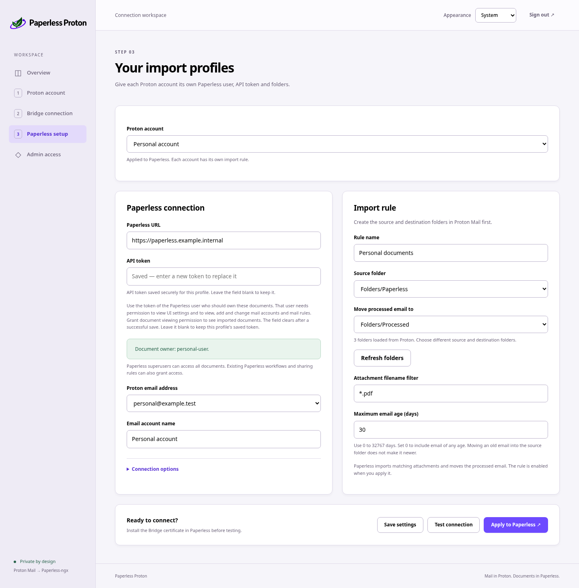

<p align="center">
  
</p>

# Paperless Proton

[](https://github.com/MErevGe/paperless-proton/actions/workflows/container.yml?query=branch%3Amain+event%3Apush)
[](LICENSE)
[](docs/setup.md)
[](#requirements)

[](https://sonarcloud.io/summary/new_code?id=MErevGe_paperless-proton)
[](https://sonarcloud.io/summary/new_code?id=MErevGe_paperless-proton)
[](https://sonarcloud.io/summary/new_code?id=MErevGe_paperless-proton)
[](https://sonarcloud.io/summary/new_code?id=MErevGe_paperless-proton)

**Import Proton Mail attachments into Paperless-ngx.**

Save invoices and other email attachments in your existing Paperless-ngx archive. Paperless Proton runs Proton Mail Bridge in Docker and gives you a web interface to connect accounts, choose folders, and configure Paperless imports.

Each separate Proton account gets its own Paperless API token, document owner, source folder, and processed folder.

[Quick start](#quick-start) · [Usage](#usage) · [Preview](#preview) · [Documentation](#documentation) · [Troubleshooting](docs/maintenance.md#troubleshooting)

## Requirements

- A [paid Proton plan that includes Mail Bridge](https://proton.me/mail/bridge).
- Docker with the Compose plugin on a **linux/amd64** or **linux/arm64** Bridge server.
- An existing Paperless-ngx installation and an API token for each intended document owner.
- Network access from Paperless to the Bridge IMAP port, and from Bridge to the Paperless API. The two applications can run on different servers.
- Access to the Paperless configuration to install the Bridge certificate.

## Quick start

For a new installation, download this repository using **Code → Download ZIP**, or clone it. Open the project directory on your Bridge server. The following commands build the image locally; for a published version, follow [Choose an image](docs/setup.md#choose-an-image).

```sh
cp .env.example .env
docker build -t paperless-proton:local .
```

Edit `.env` before starting:

- Set `BRIDGE_HOST` to the Bridge server's hostname or IP that Paperless can reach.
- Set `BRIDGE_BIND_IP` to the Bridge server's LAN or VPN IP. Allow the IMAP port, `1993` by default, only from Paperless.

Keep the other values for browser access from the Bridge host. See [address settings](docs/setup.md#set-the-addresses) for the full configuration.

```sh
docker compose up -d
docker compose ps
```

Wait for the `bridge` service to become **healthy**, then export the web certificate and retrieve the setup token:

```sh
docker compose exec -T bridge python3 -m bridge_container web-certificate > paperless-proton-web-ca.crt
docker compose exec bridge python3 -m bridge_container web-setup-token
```

Trust `paperless-proton-web-ca.crt` as a certificate authority in your browser. Open the configured `WEB_ORIGIN` (default **https://localhost:8443**), enter the setup token, and choose an admin password with at least 12 characters. To use a browser on another computer, follow [remote access](docs/setup.md#access-from-another-computer).

Complete the connection in the interface:

1. Open **Proton account** and [sign in to Proton](docs/setup.md#3-connect-proton-mail).
2. Open **Bridge connection** and [install its certificate in Paperless](docs/setup.md#4-let-paperless-trust-bridge). This is a separate certificate from the one your browser uses.
3. Open **Paperless setup** and [create an import profile](docs/import-profiles.md#create-a-profile). Select the token and folders, test the connection, check the document owner, then apply the profile.

## Usage

For example, configure a profile with `Folders/Paperless` as its source, `Folders/Processed` as its destination, and `*.pdf` as its attachment filter:

1. Move an email containing `invoice.pdf` into the `Paperless` folder in Proton Mail. The email must fall within the profile's maximum age; set the limit to `0` to include any age.
2. Wait for Paperless's scheduled mail fetch or start processing from its email account settings.
3. Sign in as the intended Paperless user and check that the document appears with the correct owner. The import rule moves the processed message into `Processed`.

Paperless retrieves attachments from Bridge over SSL/TLS and handles document processing. Its default mail-fetch interval is ten minutes; see [Paperless's mail schedule](https://docs.paperless-ngx.com/configuration/#PAPERLESS_EMAIL_TASK_CRON). For a shared installation, also [verify document visibility](docs/import-profiles.md#verify-your-first-import).

## Preview

<picture>
  <source media="(prefers-color-scheme: dark)" srcset="docs/assets/import-profile-dark.png">
  
</picture>

The interface with example data. Choose light, dark, or system mode under **Appearance**.

## Features

- **Manage multiple accounts.** Connect separate Proton accounts to different users on one Paperless server, or to different servers.
- **Choose existing folders.** Select source and processed folders directly from your Proton mailbox.
- **Control what gets imported.** Filter attachments by filename and limit the age of emails to process.
- **Set up Paperless from the browser.** Test SSL/TLS connectivity, check the document owner, and create or update the email account and rule.
- **Keep settings across restarts.** Accounts, certificates, and settings persist in a Docker volume; API tokens use an encrypted password store.

## Accounts and privacy

Use a **separate regular Paperless user for each person's profile**. The API token identifies the owner of the email account, import rule, and newly imported documents. Check the displayed **Document owner** before applying a profile.

This is a **central admin interface**: its administrators and the Bridge server can access all connected accounts. Paperless superusers can see all documents, and Paperless workflows or sharing settings can grant additional access. Profiles separate Proton accounts; additional email addresses within one account may share a mailbox.

Read [document ownership and permissions](docs/import-profiles.md#document-ownership-and-permissions) before connecting other people's accounts.

## Documentation

| I want to…                                                   | Guide                                                           |
| ------------------------------------------------------------ | --------------------------------------------------------------- |
| Install the container or connect Paperless on another server | [Setup](docs/setup.md)                                          |
| Configure accounts, API tokens, folders, and document owners | [Import profiles](docs/import-profiles.md)                      |
| Upgrade or migrate an existing installation                  | [Updates](docs/maintenance.md#update)                           |
| Back up data or recover admin access                         | [Backups and recovery](docs/maintenance.md#back-up-and-restore) |
| Fix a connection or import problem                           | [Troubleshooting](docs/maintenance.md#troubleshooting)          |

## Help and feedback

Start with [troubleshooting](docs/maintenance.md#troubleshooting). To report a problem, open an issue in this repository with your image version, architecture, the steps to reproduce it, and the exact error. Remove passwords, API tokens, email addresses, and mail content from logs or screenshots before sharing them.

For upstream help, see [Proton Mail Bridge support](https://proton.me/support/bridge) and [Paperless email import](https://docs.paperless-ngx.com/usage/#incoming-mail).

## Contributing

You can help by reporting bugs, suggesting improvements, or submitting documentation fixes and pull requests. Discuss larger changes in an issue first. Include documentation updates when a change affects setup or everyday use.

## License

Licensed under [GNU GPL v3 or later](LICENSE).
